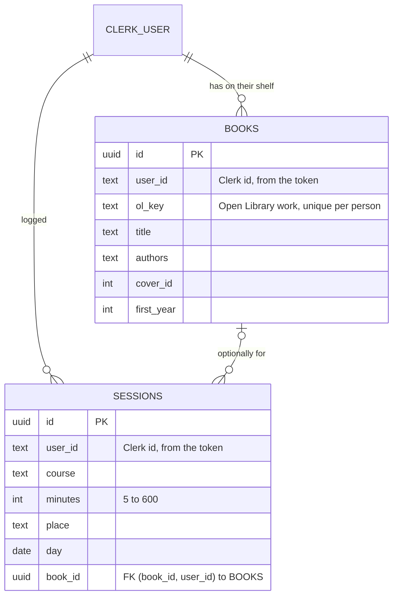
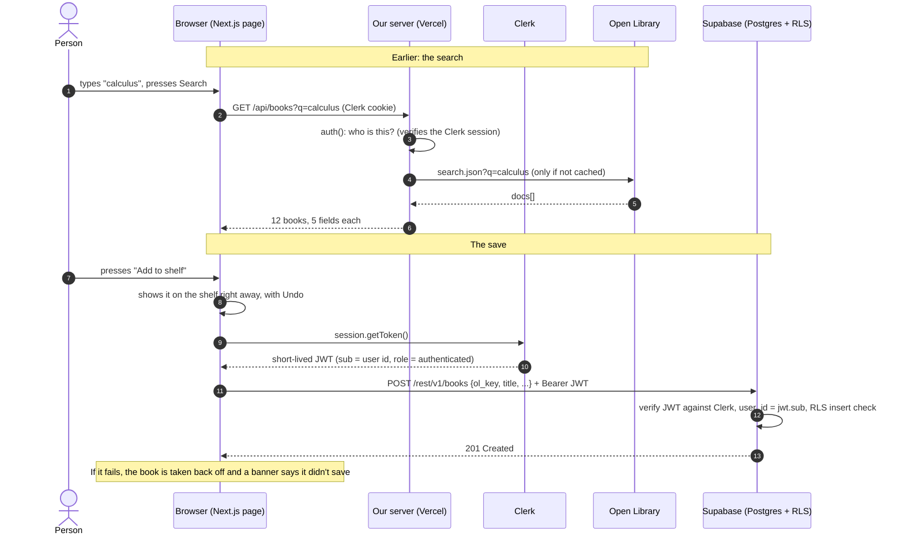

# Study Shelf

Put the books you're studying on a shelf, log the hours you spend on them, and watch your week add up toward 10 hours, on any device. Built for MPCS 51238 Design, Build, Ship, Assignment 4 (Full Stack App).

**Live:** _added after deploy_ · **Style:** the Calm design system from [Assignment 2](https://study-spots-alpha.vercel.app/design-systems/calm)

Study Shelf grows out of [Study Log](https://study-log-ashy.vercel.app) (Assignment 3). Assignment 2 told you *where* to study; Study Log tracked *how much*; Study Shelf adds *what*: the textbooks and readings, found through Open Library. It also moves everything from one browser's `localStorage` into an account, so it follows you.

**Main task:** I find my textbook → put it on my shelf → log 45 minutes of reading it → sign in on my laptop later, and the book and my week are still there.

## Stack

| Part | What it does here |
|---|---|
| Next.js 16 + Tailwind 4 | Pages, plus one server route (`/api/books`) |
| Clerk | Sign up, sign in, sign out. Development keys. |
| Supabase | Postgres with row-level security, connected to Clerk through third-party auth |
| Open Library | Book search and covers (no key) |
| Playwright | One end-to-end test: two people can't see each other's data |

## Pages

- `/` signed out: what the tool does, and Create account / Sign in. **No data.** Signed in: Today (first-visit starters, or Welcome back with progress and "Log again").
- `/shelf` search Open Library, add books, see your shelf and the time logged on each book.
- `/log` log a session, optionally for a book on your shelf (`/log?book=…` from the shelf).
- `/week` this week and last week, sessions by day, Undo.

## Data

Two tables. Every row belongs to one person through `user_id`, the Clerk user id. The database fills it in from the sign-in token (`default auth.jwt() ->> 'sub'`), so the browser never sends it and can't fake it.



The foreign key is `(book_id, user_id) → books(id, user_id)`, so a session can only point at a book on **the same person's** shelf. Removing a book keeps its sessions and clears only `book_id`. Migrations are in [`supabase/migrations/`](supabase/migrations/).

Kept only on the device (per user, in `localStorage`): the half-typed form draft and the last-visit day for "Welcome back".

## How access is controlled

**Who someone is:** Clerk. `src/proxy.ts` runs `clerkMiddleware()` on every request, which reads the Clerk session cookie. In the browser, Clerk gives a short-lived session token.

**What they may see:** decided in two places.
1. **Next.js (pages):** `/shelf`, `/log` and `/week` call `await auth.protect()`, which sends a signed-out visitor to sign-in. `/api/books` checks `auth()` and answers 401. Signed-out `/` is only the landing page.
2. **Supabase (data), the one that really matters:** row-level security on both tables. Each request carries the Clerk token; Supabase verifies it (third-party auth, Clerk domain `merry-sloth-9459.clerk.accounts.dev`) and runs the policies:

| Table | Policy | In plain words |
|---|---|---|
| books, sessions | select `using ((select auth.jwt()) ->> 'sub' = user_id)` | You only get back rows with your id on them. |
| books, sessions | insert `with check (… = user_id)` | You can only add rows with your own id. Writing someone else's id is refused. |
| books, sessions | delete `using (… = user_id)` | You can only delete your own rows. |
| both | `anon` has no grants at all | Signed out, every query is refused ("permission denied"). |

There are no update policies, because nothing in the app edits a row.

A query RLS blocks: signed in as B, `insert into books (user_id, ol_key, title) values ('user_A…', '/works/OL1W', 'Planted')` fails with `new row violates row-level security policy for table "books"`. And `select * from sessions` as B returns only B's rows, even though there's no `where`.

The app's queries deliberately have **no** `where user_id = …`. RLS is the only thing deciding whose rows come back, which is what makes the test below meaningful.

## Where the API is called, and why

On **our server**, in [`src/app/api/books/route.ts`](src/app/api/books/route.ts), for signed-in people only. Open Library needs no key, so it's not about secrets. It's about:

- **Caching:** results are cached per query for a day (`'use cache'` + `cacheLife('days')`). The first search takes about 5 seconds; the same search again takes about 10 ms, and Open Library gets one request instead of one per person.
- **Rate limits / politeness:** one place sets a `User-Agent` and a 6-second timeout, and only signed-in people can use it.
- **One shape, designed failures:** the route trims the response to five fields, and turns "slow or down" into a 503 the page shows as a designed state.

Covers are plain `` tags straight from `covers.openlibrary.org`.

| State | What you see |
|---|---|
| Loading | "Searching Open Library for …" with placeholder rows; after 3 seconds, "It can take a few seconds." |
| Nothing found | "No books match "…"". Check the spelling, or try just the title or the author's last name. |
| Open Library down or slow (503, or no answer in 10 s) | "Open Library isn't answering". Your shelf and sessions are safe. **Try again** |
| Too short | Error next to the field: "Type at least 2 characters, like a title or an author." |
| Signed out mid-visit (401) | "You've been signed out" · Sign in again |

### One request, from the click to the screen

Someone presses **Add to shelf** on a search result:



## The test

[`tests/isolation.spec.ts`](tests/isolation.spec.ts): two Clerk test users sign in, in separate browsers. A searches Open Library, adds *Introduction to Algorithms* and logs a session; B adds *Pride and Prejudice* and logs one. Then each loads `/week` and `/shelf` fresh from the database. Each must see their own and **never** the other's. Names are unique per run, so leftovers from an earlier run can't make it pass.

```bash
npx playwright test   # starts `next dev` on :3100 and reads .env.local
```

**Watching it fail:** migration [`…_break_rls_on_purpose.sql`](supabase/migrations/20261027061554_break_rls_on_purpose.sql) changed both select policies to `using (true)`. The test failed: A's week showed B's session (`Expected: 0, Received: 2`). The full output is in [`docs/test-failing-with-rls-broken.txt`](docs/test-failing-with-rls-broken.txt). Migration [`…_restore_rls.sql`](supabase/migrations/20261027061649_restore_rls.sql) put `(select auth.jwt()) ->> 'sub' = user_id` back, and it passed again. Both are in the commit history.

In one sentence: *with the select policy set to `true`, Postgres returned every row to whoever asked, and since the app never filters by user itself, B's session showed up on A's week.*

## Keys

- In `.env.local` locally and in Vercel's environment variables in production; `.env*` is in `.gitignore`.
- `.claude/settings.json` denies the agent `Read(./.env)`, `Read(./.env.*)` (and `**/` versions, in case it's started from a parent folder).
- `NEXT_PUBLIC_CLERK_PUBLISHABLE_KEY`, `NEXT_PUBLIC_SUPABASE_URL` and `NEXT_PUBLIC_SUPABASE_PUBLISHABLE_KEY` are meant to be public: they reach the browser, and security comes from Clerk's checks and RLS. `CLERK_SECRET_KEY` is server-only. The Supabase secret key isn't used anywhere: it would skip RLS.

## Working with the agent

Built with Claude Code, step by step, on the branch `feature/full-stack`. Things that were stopped or caught along the way:

- **Stopped:** the agent can't read `.env*` files (deny rule). Supabase keys were looked up through the MCP server and appended to `.env.local` without reading it. Clerk keys were written by `clerk init`, never shown.
- **Stopped:** a migration that dropped and re-created the RLS policies was declined. It was rewritten as `alter policy`, so nothing was ever dropped.
- **Caught:** Clerk 7 deprecates `createRouteMatcher`, so each page and route checks auth itself and `proxy.ts` stays bare.
- **Caught:** with `cacheComponents`, `usePathname()` in the header broke the build on the sign-in route; that part of the nav now renders inside `<Suspense>`.
- **Caught:** the footer still said "Saved on this device. No account needed." after accounts were added.
- **Caught by the Supabase advisor:** the RLS policies re-evaluated the token per row, and a foreign key had no index; both fixed in a migration.
- **Caught:** the first test run failed on its own locator (a course name shows twice on `/week`), not on the app; scoped to the Sessions list.
- `/security-review` was run on the branch before merging: no findings. See [`docs/security-review.md`](docs/security-review.md).

## Free tiers

Vercel Hobby, Clerk development instance, Supabase Free (pauses after a week without use, so open the app now and then), Open Library (free, and cached so it isn't hammered). No payment method on any of them.

## Run it

```bash
npm install
# .env.local: NEXT_PUBLIC_CLERK_PUBLISHABLE_KEY, CLERK_SECRET_KEY,
#             NEXT_PUBLIC_SUPABASE_URL, NEXT_PUBLIC_SUPABASE_PUBLISHABLE_KEY
npm run dev            # http://localhost:3000
npx playwright test    # the two-user test
npm run build
```
