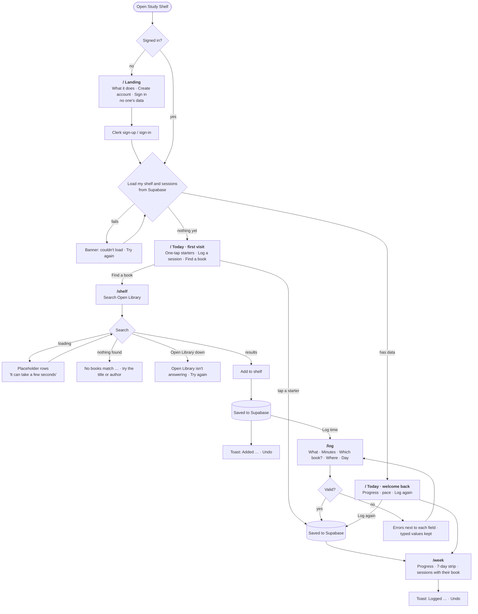

# Study Shelf flows

**Main task:** I find my textbook → put it on my shelf → log 45 minutes of reading it → sign in on my laptop later, and the book and my week are still there.

## States per page

| Page | Empty / first | Loading | Error | Success |
|---|---|---|---|---|
| `/` signed out | Landing, no data | — | — | Sign up / Sign in |
| `/` signed in | Starters + Find a book | Skeleton | Couldn't load · Try again | Welcome back with progress |
| `/shelf` | "Your shelf is empty" | Placeholder rows, then "It can take a few seconds" | Nothing found · Open Library isn't answering · Signed out | Toast "Added … · Undo" |
| `/log` | Defaults, "No book" (links to the shelf) | Skeleton | Field errors with next step; "didn't save" banner | Redirect to `/week` with toast |
| `/week` | "No sessions this week yet" + Log a session | Skeleton | Couldn't load · Try again | Toast with Undo |
